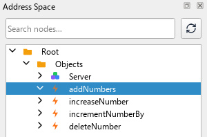
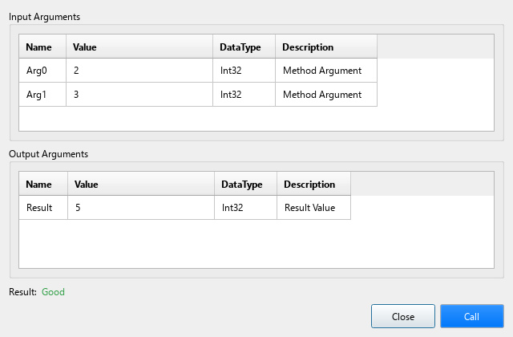
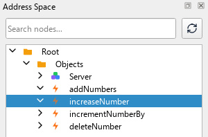
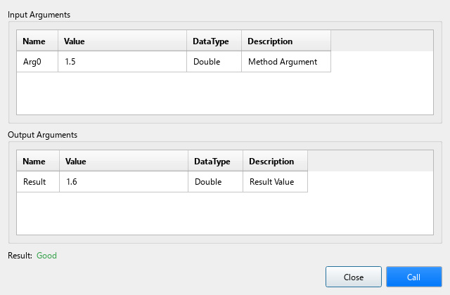
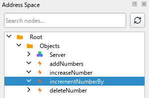
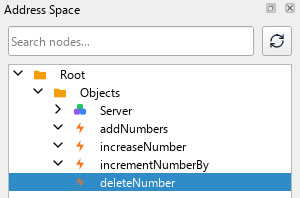

# Methods

In OPC UA, *BaseObjects* instances can have methods. To support this, the *QUaBaseObject* API has the `addMethod()` method which allows to define a name for the method and a callback.

Since the *Objects Folder* is an instance of `QUaBaseObject`, it is possible to add methods to it directly, for example:

```c++
int addNumbers(int x, int y)
{
	return x + y;
}

int main(int argc, char *argv[])
{
	QCoreApplication a(argc, argv);

	QUaServer server;

	QUaFolderObject * objsFolder = server.objectsFolder();

	// add a method using callback function
	objsFolder->addMethod("addNumbers", &addNumbers);

	server.start();

	return a.exec(); 
}
``` 

Which can be remotely executed using a client.

<p align="center">
  
  <br>
  
</p>

Note that the *QUaServer* library automatically deduces the arguments and return types. But only the types supported by the `setDataType()` method (see the [Basics](01_basics.md) section), and `QList<T>` or `QVector<T>` of them, are supported by the `addMethod()` API.

A more *flexible* way of adding methods is by using **C++ Lambdas**:

```c++
objsFolder->addMethod("increaseNumber", [](double input) {
	double increment = 0.1;
	return input + increment;
});
```

<p align="center">
  
  <br>
  
</p>

Using the *Lambda Capture* it is possible to change *Objects* or *Variables* (the pointer is captured by reference so that the `deleteNumber` method below can reset it):

```c++
auto varNumber = objsFolder->addBaseDataVariable("Number");
varNumber->setValue(0.0);
varNumber->setDataType(QMetaType::Double);

objsFolder->addMethod("incrementNumberBy", [&varNumber](double increment) {
	if (!varNumber)
	{
		return false;
	}
	double currentValue = varNumber->value().toDouble();
	double newValue = currentValue + increment;
	varNumber->setValue(newValue);
	return true;
});
```

<p align="center">
  
  <br>
  
</p>

Using methods we can even **delete** *Objects* or *Variables*:

```c++
objsFolder->addMethod("deleteNumber", [&varNumber]() {
	if (!varNumber)
	{
		return;
	}
	delete varNumber;
	varNumber = nullptr;
});
```

<p align="center">
  
  <br>
  
</p>

## Methods Without C++ Callback

Methods that exist without a C++ callback, such as the methods of a loaded NodeSet (see [NodeSets](12_nodesets.md)), fail with `BadNotImplemented` until `QUaServer::setMethodHandler()` gives them a handler. `inputArguments()` and `outputArguments()` read what the method declares:

```c++
QUaNodeId doseId(ns, 5006);
qDebug() << server.inputArguments(doseId).first().name; // "Volume"

server.setMethodHandler(doseId, [](const QUaNodeId& objectId, const QVariantList& inputs, QVariantList& outputs) {
	if (inputs.first().toDouble() <= 0)
	{
		return UA_STATUSCODE_BADINVALIDARGUMENT;
	}
	outputs = { inputs.first().toDouble() / 1.4 };
	return UA_STATUSCODE_GOOD;
});
```

*open62541* checks the inputs against the `InputArguments` property before the handler runs. The outputs are converted to the data types of the `OutputArguments` property, enumerations to `Int32`; missing ones get the default value of their data type, and one that cannot be converted fails the call with `BadInternalError`. Instances of a type may share the method node of the type, so `objectId` tells which object the method is called on. An empty handler makes the method fail with `BadNotImplemented` again; methods of namespace 0 and methods with a C++ callback are refused.

## Methods Example

Build and run the [02_methods](../examples/02_methods/main.cpp) example to learn more.
